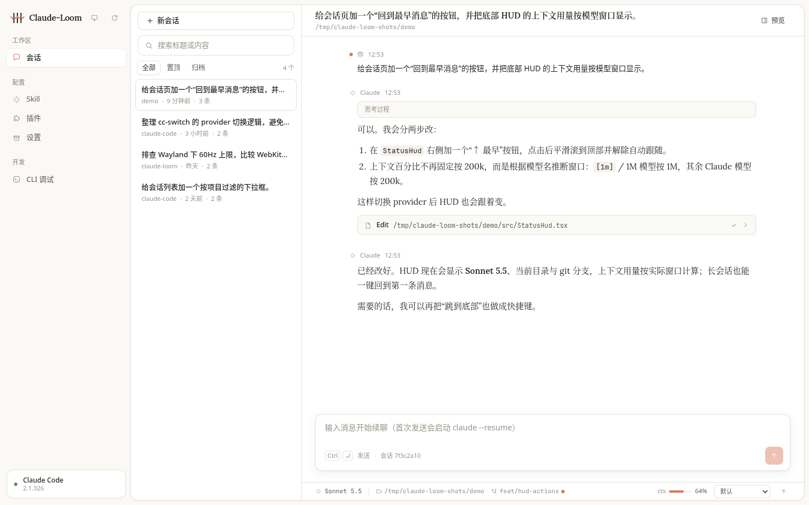
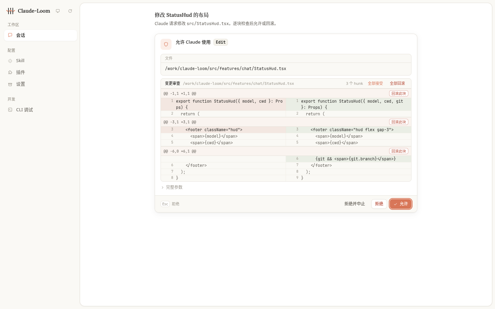
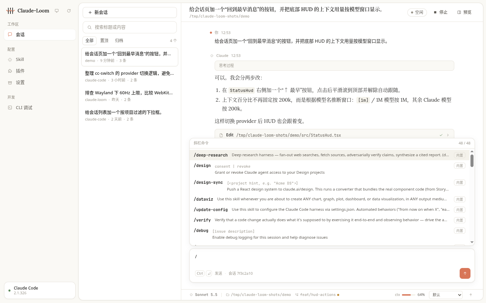
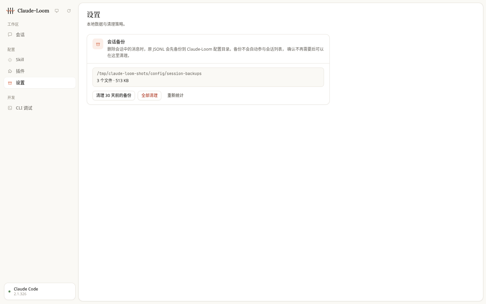
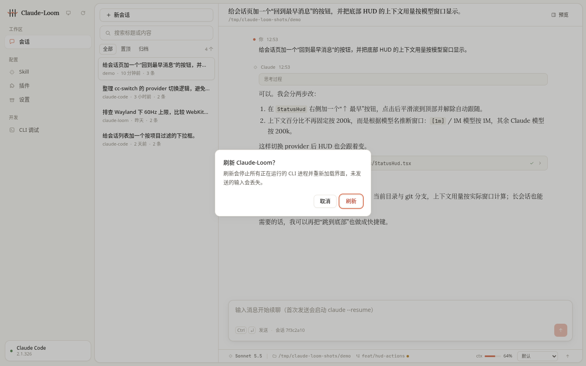

# Claude-Loom

Claude Code CLI 的图形外壳。渲染层是 React 19 + TypeScript + Tailwind 4，跑在 **Electron 45 / Chromium** 上；
业务后端是一个独立的 Rust sidecar 进程（`loom-backend`），通过 JSON-RPC over stdio 与 Electron 主进程通信。

Claude-Loom 只是一层薄壳：不负责安装 CLI，也不处理网络或模型适配。它假设 `claude` 已经安装好并且在 PATH 中
（也可以在界面配置里指定路径）。Provider / API Key 由 [cc-switch](https://github.com/farion1231/cc-switch)
或 Claude Code 自己的 `settings.json` 管理，Claude-Loom 不保存密钥、也不修改 settings。

## 截图

| 会话、HUD 与工具卡片 | Edit / Write 的并排 diff 审查 |
| --- | --- |
|  |  |

| 全部斜杠命令（不截断） | 设置与备份清理 |
| --- | --- |
|  |  |



## 为什么用 Electron

Linux 上的 Tauri 使用 WebKitGTK。WebKitGTK 2.54 在 Wayland 下把上屏帧率硬限制在 60fps：
`PreferPageRenderingUpdatesNear60FPS` 默认开启、VBlank 监视器在没有 displayID 时固定 60Hz、
渲染更新间隔 15ms。逐层补丁（监视器 200Hz、关闭 feature、trampoline 相关函数）之后，
Wayland surface commit 仍然精确是 60fps。

同一台机器、同一个 KWin/Wayland 会话，Electron 稳定 **200fps**（2560×1440@200Hz）。
所以 Claude-Loom 0.5 起改用 Electron：

- 渲染：Electron 45 / Chromium（Wayland 原生，`requestAnimationFrame` 跟随显示器刷新率）
- 前端：React，通过 `window.loom` 桥调用主进程
- 后端：Rust sidecar 复用会话、配置、Skill、插件、CLI、预览逻辑

## 架构

```
┌───────────────────────────── Electron ─────────────────────────────┐
│  renderer (React)  ←─ preload.cjs (contextBridge) ─→  main.cjs     │
│                                                         │ IPC      │
└─────────────────────────────────────────────────────────┼──────────┘
                                                          ▼
                                   loom-backend（Rust sidecar，stdio JSON-RPC）
                                   ├─ 会话 JSONL 扫描 / 分叉 / 删除 / 备份
                                   ├─ claude CLI 子进程 + NDJSON 流
                                   ├─ 配置 / Skill / 插件 / 文件预览 / diff 读取
                                   └─ 事件：{"event":"loom://cli","payload":...}
```

sidecar 通过 `#[path]` 直接包含 `sidecar/backend/src` 的模块；项目里不再保留 Tauri 外壳。

## 功能

- **会话**：读取 `~/.claude/projects/*/*.jsonl` 与本机运行记录 `~/.claude/sessions/*.json`，
  列出标题、项目、时间、消息数与运行状态；支持按标题/内容搜索、置顶、归档、删除。
  点击会话查看历史，发送消息时以 `claude --resume <sessionId>` 续聊。
  只有运行记录、没有 transcript 的会话不会出现在列表中。
- **侧问**：主对话生成时，输入区会出现闪电按钮。点击后在当前会话上下文里提一个简短问题，
  主对话不会中断。侧问通过 `--resume --fork-session --no-session-persistence --tools ""` 运行，
  不写入原 transcript，也不执行工具。
- **Diff 审查**：Edit / Write 的权限确认卡会显示并排 diff；可以逐个 hunk「回滚」或「接受」，
  被回滚的片段不会交给 CLI，全部接受后行为与原工具调用一致。
- **斜杠命令**：输入 `/` 显示 CLI 返回的全部命令 / Skill（不截断），↑↓ 选择，Enter 或 Tab 填入。
- **Skill**：扫描 `~/.claude/skills/*/SKILL.md`，启停、编辑 frontmatter 与正文、新建 Skill。
- **插件**：列出已安装插件；添加外部插件目录并通过 `--plugin-dir` 传给 CLI。
- **附加文件**：输入框旁的加号可以选择多个文件，也可以直接把文件/目录拖进对话区。
  附件以下一条消息的绝对路径列表发送，Claude 可通过 Read / Glob 读取；发送前可随时移除。
- **消息操作**：复制整条消息或代码块；从任意助手回复分叉出新会话；
  删除用户输入或助手回复（按整轮删除，原 JSONL 自动备份到配置目录）。
- **新会话**：会话列表顶部的「新会话」，选择目录后直接开始。
- **预览**：与对话并排、可折叠；Markdown、图片、代码高亮（Shiki），
  localhost 网页内嵌，其余可在系统浏览器打开。
- **深色模式**：跟随系统 / 浅色 / 深色三态切换，代码高亮同步。
- **权限**：CLI 的工具权限请求会变成确认卡片（允许 / 始终允许 / 拒绝 / 拒绝并中止）。
- **HUD**：底部状态栏显示当前模型、会话目录、git 分支 / dirty / ahead-behind、
  上下文用量（tokens 与百分比）；可直接切换权限模式
  （default / acceptEdits / plan / bypassPermissions），并一键回到最早消息。
- **刷新**：侧栏刷新按钮 / `F5` / `Ctrl+R`，确认后停止所有 CLI 进程并重新加载页面。
- **字体**：内置完整思源宋体 CN（Regular / SemiBold，约 3 万字符），生僻字不回退系统字体。

## 数据位置

| 内容 | 位置 |
| --- | --- |
| Claude Code 数据 | `$CLAUDE_CONFIG_DIR`，未设置时为 `~/.claude` |
| Claude-Loom 配置（插件目录、会话标记、CLI 路径/权限模式） | Electron `appData/dev.loom.app`：Linux `~/.config/dev.loom.app`、macOS `~/Library/Application Support/dev.loom.app`、Windows `%APPDATA%\dev.loom.app` |
| 会话删除时的原文件备份 | `~/.config/dev.loom.app/session-backups`（各平台在对应配置目录下） |
| claude 可执行文件 | PATH；可在界面配置里指定 |

「设置 → 会话备份」可以查看备份占用，并一键清理全部备份或只清理 30 天前的文件。
Provider / API Key 由 cc-switch 或 `settings.json` 管理；Claude-Loom 不读取也不写入。

## 安装

从 [Releases](https://github.com/HyotMakFin/claude-loom/releases) 下载 0.6.2 的安装包。

**Linux（AppImage）**

```bash
chmod +x Claude-Loom-0.6.2.AppImage
./Claude-Loom-0.6.2.AppImage
```

无 FUSE 时：`./Claude-Loom-0.6.2.AppImage --appimage-extract-and-run`。

**Windows**

运行 `Claude-Loom-0.6.2-Setup.exe`。未签名，SmartScreen 提示时选择「更多信息 → 仍要运行」。

**macOS**

打开 `Claude-Loom-0.6.2-universal.dmg`，把 Claude-Loom 拖进 Applications；未签名，首次启动右键 → 打开，
或 `xattr -dr com.apple.quarantine /Applications/Claude-Loom.app`。

## 开发

```bash
npm install
(cd sidecar && cargo build)   # 首次：构建 Rust sidecar
npm run build                 # 构建前端到 dist/
npm run electron              # 启动 Electron（加载 dist/）
```

| 命令 | 用途 |
| --- | --- |
| `npm test` | 前端单测 |
| `npm run typecheck` | TypeScript 检查 |
| `(cd sidecar && cargo test)` | Rust 后端单测 |
| `npm run fonts` | 重新生成打包字体（Lora / 思源宋体 / JetBrains Mono） |

调试时可设置 `LOOM_DEBUG=1` 看渲染进程 console，`LOOM_BACKEND=/path/to/loom-backend` 指定 sidecar。

## 打包

```bash
(cd sidecar && cargo build --release)
npm run build
npx electron-builder --linux AppImage   # Linux AppImage
npx electron-builder --win              # Windows NSIS
npx electron-builder --mac --universal  # macOS 通用 DMG（需 macOS）
```

产物在 `release/`。Linux AppImage 可在本地构建；Windows / macOS 需要各自的 runner，
仓库里的 `electron-release.yml` 会构建 AppImage、NSIS 与通用 DMG 并上传到指定 Release。

## 帧率验收

```bash
LOOM_FPS_OVERLAY=1 ./release/Claude-Loom-0.6.2.AppImage
```

右下角会显示当前 rAF 帧率。在 200Hz 显示器上实测稳定 **200.0 fps**。

## 品牌

标志为一根橙色纬线以拱形越过中间经线、从两侧经线背后穿过——「织机」的经纬交织。
品牌资源由 `scripts/build-logo.py` 生成到 `assets/brand/`；Electron 使用 `electron/icon.png`。
